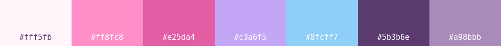

<div align="center">

# 🎀 angel-dotfiles

**Rice pastel para Arch + Hyprland (config en Lua) · rosa · lavanda · azul**



*(˘ω˘) hecho con mucho cariño ♡*

</div>

---

## ✧ Qué trae

| | |
|---|---|
| **Hyprland 0.57 (Lua)** | Bordes con degradado que gira, animaciones con rebote, blur, hyprbars, gestos (3 dedos: escritorios · 4 dedos ↑ vista general · ↓ escritorio) |
| **Waybar** | Barra arriba + **dock flotante** abajo con iconos que rebotan, kaomojis por escritorio, cava, info de sistema |
| **☾ Modo Ame / ♡ Modo Angel** | Un atajo cambia TODO el rice entre pastel y oscuro. Se activa solo al anochecer |
| **🎨 Colores del wallpaper** | Opcional: todo el rice toma el color principal de tu fondo |
| **Widgets de escritorio** | Reloj, clima, próxima clase (con aviso), estado del sistema, cuenta regresiva, calendario, polaroids, pomodoro, notitas, frase del día, música |
| **Rofi** | Lanzador, selector de wallpapers con miniaturas, vista general de ventanas, portapapeles, **kaomojis**, menús de wifi y disco |
| **Swaync** | Notificaciones + centro de control con toggles (wifi, bt, luz nocturna, modo Ame…) |
| **Hyprlock / hypridle** | Bloqueo con avatar, batería, canción y frase · protector de pantalla cute · ahorro de batería |
| **Sonidos** | Ding de notificación, pop al cambiar de escritorio, bienvenida y despedida (generados, originales) |
| **Extras** | Modo showcase (`SUPER+G`), cursor angel, carpetas rosas, wlogout con iconos dibujados, starship, kitty, btop, cava, spicetify, SDDM y Plymouth |

<div align="center">
<br>

</div>

## ✧ Atajos principales

| Atajo | Qué hace |
|---|---|
| `SUPER + /` | Ver todos los atajos ♡ |
| `SUPER + R` | Lanzador de apps |
| `SUPER + W` | Elegir wallpaper |
| `SUPER + SHIFT + A` | Modo Ame / modo Angel |
| `SUPER + Tab` | Vista general de ventanas |
| `SUPER + G` | Modo showcase ✨ |
| `SUPER + .` | Kaomojis (˘ω˘) |
| `SUPER + SHIFT + D` | Widgets on/off |
| `SUPER + A` | Centro de control |
| `SUPER + X` | Menú de apagado |

## ✧ Instalar

```bash
# dependencias (Arch)
sudo pacman -S hyprland hyprlock hypridle hyprpaper hyprsunset hyprpicker waybar rofi swaync wlogout \
  kitty starship btop cava fastfetch cliphist wl-clipboard grim slurp jq playerctl brightnessctl \
  python-gobject gtk-layer-shell python-psutil imagemagick papirus-icon-theme ttf-jetbrains-mono-nerd noto-fonts

git clone https://github.com/christiaaandiooor/angel-dotfiles
cd angel-dotfiles
./install.sh TuNombre
```

El instalador respalda tus archivos antes de reemplazarlos (`~/.config/angel-backup-FECHA`).

**Imágenes:** los wallpapers y el avatar no vienen en el repo (son fan art de sus autores).
Pon los tuyos en `~/Pictures/wallpapers/` (`escritorio.jpg`, `bloqueo.png`, `menu.jpg`) y en `~/.config/fastfetch/logos/k-angel.png`.

**Horario:** el widget de clases trae un horario de ejemplo; cámbialo en `~/.config/hypr/widgets/angel-desk.py` (`H = {...}`).

**Login y arranque (opcional, pide sudo):** `sudo bash ~/.config/angel-system/instalar.sh`

---

<div align="center">✧ inspirado en la estética de NEEDY STREAMER OVERLOAD · hecho para presumir ♡ ✧</div>
